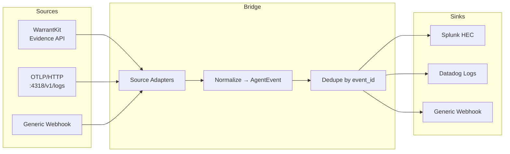

# agent-evidence-bridge (public notes)

**Universal SIEM bridge for AI agent evidence**

Open-core companion to [WarrantKit](https://github.com/Therealdk8890/WarrantKit) (runtime enforcement & proof platform for autonomous agents by Daniel Kissel).

This project turns agent runtime evidence into something security teams can actually use: normalized events that land in Splunk, Datadog, or any webhook — without breaking the trust boundary that authority stays with the runtime.

> **Note:** The implementation repositories (`agent-evidence-bridge` and `warrantkit-siem-bridge`) are currently private. This public repo contains the README, architecture overview, and design notes so recruiters and collaborators can see the scope of the work.

---

## Why it exists

Agent runtimes produce valuable evidence (policy decisions, containment events, receipts). Most SIEM tools have no native understanding of that data. Security teams won’t adopt a kill-switch or proof system if they have to compile from source and hand-roll parsers.

`agent-evidence-bridge` fills the gap:

- **Ingest** from WarrantKit Evidence API, OTLP/HTTP, or generic webhooks
- **Normalize** into a stable `AgentEvent` model
- **Dedupe** by event/receipt ID so duplicate delivery is not a new event
- **Forward** to Splunk HEC, Datadog Logs, or any HTTPS webhook
- **Deploy** via Helm so the bridge (and optionally the runtime) lands in an existing cluster

---

## Architecture

**Design rules (inherited from WarrantKit contracts)**

- Evidence flows **out** from the runtime. Authority does **not** flow in from the bridge or SIEM.
- The bridge transports, normalizes, and presents evidence. It never upgrades an enforcement result into a stronger security claim.
- If the sink is down, the source runtime is unaffected.
- Ingestion is idempotent by `event_id` / receipt ID.

---

## Related private repositories

| Repo | Focus |
|------|-------|
| `agent-evidence-bridge` | Multi-source bridge (WarrantKit + OTLP + webhooks) |
| `warrantkit-siem-bridge` | WarrantKit-specific packaging + Helm chart |

Both share the same design principles and trust-boundary rules.

---

## Credits

- **WarrantKit, AgentContainment, and the Evidence API contracts** were created by **Daniel Kissel** ([Therealdk8890](https://github.com/Therealdk8890)). All runtime authority, epoch fencing, containment, and evidence semantics originate in his work.
- Bridge implementation: **Th3Krack3r** / West Electronics LLC

This is a companion project, not a fork or replacement of WarrantKit.

---

## License

Apache-2.0 (intended for the open-core bridge)
